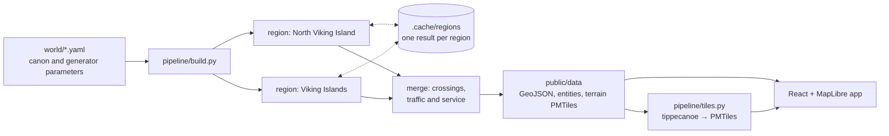

# World Atlas · 世界地图

[](https://github.com/AndyUneducated/world-atlas/actions/workflows/deploy.yml)


An interactive atlas of **Homeworld**, a fictional planet. The mapped regions are the
Territory of North Viking Island (北维京岛领地) and the Territory of the Viking Islands
(维京群岛领地), China.

Live site: https://andyuneducated.github.io/world-atlas/

## How it works

Everything on the map is generated from the YAML files in `world/`. Nothing in
`public/data/` is edited by hand.



Each region (territory) is built on its own from its generator file. Its terrain, coast,
districts, roads, railways, streets and buildings come out as one result, which is cached
under the hash of its inputs and the pipeline code. The regions are then merged: lines
between territories are joined through their undersea tunnels, and the traffic and service
figures on the route cards are computed over the whole map.

| Path | Contents |
|:--|:--|
| `world/planet.yaml` | Planet and coordinate reference system |
| `world/registry/` | Countries (ISO 3166-1) |
| `world/divisions/` | Administrative divisions: territory, cities, districts |
| `world/features/` | Natural features: mountain ranges, rivers, lakes, coastal landforms (bays, fjords, capes, straits, islands, river mouths), peaks, passes and glaciers |
| `world/transport/` | Numbered routes (expressways, highways) and intercity railways |
| `world/places/` | Landmarks, buildings and transport facilities (airports, ports, harbours, spaceports) |
| `world/generator/` | Layout parameters: coastline, terrain, city anchors, seeds |
| `pipeline/` | Python generator |
| `src/` | Web app |

The pipeline is seeded and deterministic: the same YAML always produces the same map.
Changing a city's area, moving its anchor, or adding a route only means editing YAML and
re-running the build.

Rivers, coastal landforms, peaks, passes and glaciers are found by the generator. An entry in `world/features/`
names one with `detect: {kind, at_km}`, which claims the nearest landform of that kind.
After each build, `.cache/candidates-<territory>.json` lists every landform found,
named or not, with its district and size, so new ones can be named by adding entries.

Entities can also be added or edited in bulk from a spreadsheet:
`npm run data:import -- file.csv` checks every row and writes into `world/` only if the
whole file passes. Templates and a guide (in Chinese) are in [`templates/csv/`](templates/csv/README.md).

## Conventions

- **IDs.** Each entity has a permanent ID (`div_…`, `nat_…`, `rte_…`, `poi_…`, `bld_…`)
  that never changes. Business codes (division codes, ISO codes, route numbers) are
  separate fields and may change. They always run in order with no gaps: when a route or
  division is added, removed or regraded, the numbers after it close up, and freed numbers
  are reused.
- **Status.** `canon` comes from the world setting. `generated` was filled in by the
  generator or an assistant and is pending review.
- **Names.** BCP 47 keys: `zh`, `en`, `art-x-viking`, `art-x-buckham`.
- **Hierarchy.** Country → territory (`dependency`) → city (`locality`) → district
  (`borough`), following the Overture Maps division subtypes. Division codes follow the
  six-digit GB/T 2260 pattern (`900000` → `900100` → `900101`).
- **Regions.** Each territory has one generator file, `world/generator/<region>.yaml`
  (`cn-nv`, `cn-vk`); its natural features live in `world/features/<region>-*.yaml` and are
  only matched and used for street names inside that region.
- **Routes.** Four grades, the same in every territory: national expressways `G-NV-1…`,
  territorial expressways `S-NV-1…`, territorial highways `S-NV-101…` and city roads
  `X-NV-001…` (with the territory infix: `NV`, `VK`). A route's
  `via` lists cities or districts; `ring`, `straight` (straight legs, crossing hills and
  water on structures) and per-leg `legs` overrides shape the path. Territorial routes name
  a `shield` glyph for the upper half of their sign.
- **Engineering.** `world/transport/engineering.yaml` holds the standard of each road and
  rail network: grade limits, bridge and tunnel thresholds, unit costs in US dollars, speed
  limits, cross-sections and technical data. The generator derives each route's bridge and
  tunnel lengths (and names its longest bridge and tunnel), construction cost, yearly upkeep
  and per-segment speed limits from it. Daily traffic, lanes, railway ridership and headways
  come from gravity models over the people along each line. Expressways, territorial
  highways and railways carry a `background` (why and how they were built), and each
  territory names the `operators` of its expressways, highways and railways.
- **Streets.** City streets are generated from the `streets` section of a generator file:
  each district's built-up area gets arterials (主干道), collectors (次干道) and local
  streets (支路) in a planned, mixed or organic style. Fixed names such as 人民大道 are
  pinned to grid lines under `named`; all other names are composed from the stems and
  suffixes in `world/names/streets.yaml`. Arterials and collectors are clickable routes;
  local streets are drawn and labelled only.
- **Buildings.** The blocks between a city's streets are filled with generated building
  footprints whose type (slab estates, towers, courtyard blocks, shops, houses, sheds, parks)
  follows the district style, optionally weighted per district (`mix`). Places with a `site` (size and layout template) are drawn as
  clickable landmarks; streets and generated buildings keep out of their grounds.
  The `airport`, `port` and `spaceport` layouts draw runways, piers and launch pads, and an
  optional `angle_deg` turns a site to an absolute bearing (east = 0°, counter-clockwise).
  A `harbour` is a dug-basin port: its `terminals` (`container`, `bulk`, `oil`, `roro`) fill
  the moles between the basins in order, behind breakwaters and in front of a rail yard. An
  `offshore_port` is a reclaimed island whose sea bridge lands next to the harbour named in
  `bridge_to`. Ports and harbours snap to the nearest coast and airports and spaceports step
  inland off the water, so sites stay in place when the districts are repartitioned.
- **Railways.** Intercity lines in `world/transport/*-rail.yaml` list their stops (cities
  or districts) and are laid over the terrain with gentler gradients than roads; `tech`
  sets their operating and design speeds. City metro
  lines come from the `metro` section of a generator file and stay inside a district's
  built-up area. Stations are places of subtype `station`; lines and stations get IDs
  derived from stable keys, so they survive rebuilds.

## Development

Requirements: Node 22+ and Python 3.12+.

```sh
pip install -r pipeline/requirements.txt
npm install
npm run data        # generate public/data
npm run dev         # http://localhost:5173
```

A full build from scratch takes about 25 minutes; with an unchanged region taken from the
cache, about 11. Options of `pipeline/build.py`:

| Option | Effect |
|:--|:--|
| `--check` | Validate the YAML without generating anything (`npm run data:check`) |
| `--only <region> …` | Rebuild only the named regions (`cn-nv`, `cn-vk`); the others come from their last cached result, even if out of date |
| `--fresh` | Ignore the cache |

The build fails if two territories' land overlaps. Pushing to `main` runs the pipeline and
deploys to GitHub Pages through `.github/workflows/deploy.yml`; CI keeps `.cache` between
runs, so only the regions that changed are rebuilt.

Display-only layers with many features (land cover, streams, sea depth, streets, buildings) are packed into a
[PMTiles](https://docs.protomaps.com/pmtiles/) vector tile archive by `pipeline/tiles.py`
with [tippecanoe](https://github.com/felt/tippecanoe), and the site reads them tile by tile.
CI always builds the archive; locally it is optional, and without tippecanoe the site loads
the same layers as GeoJSON.

Design decisions made without an explicit instruction are recorded in
[`DECISIONS.md`](DECISIONS.md).

## License

Code: MIT. World content (`world/` and the generated map data): CC BY-NC-SA 4.0.
See [`LICENSE`](LICENSE).
